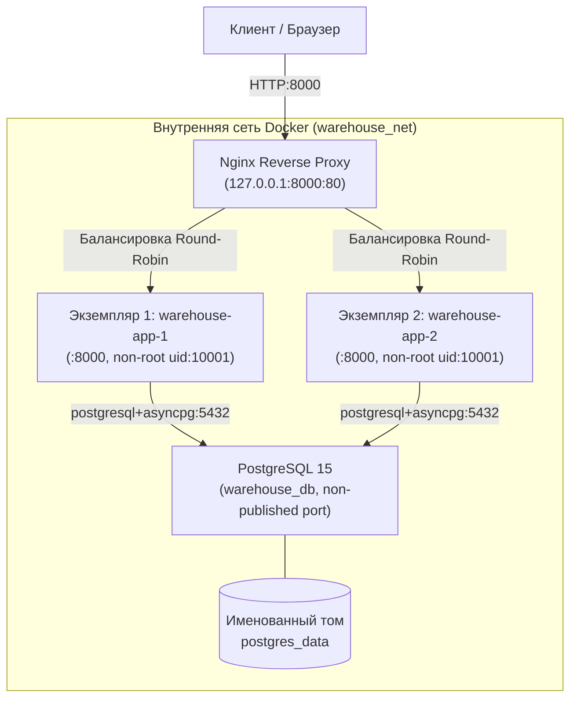

# Лабораторная работа №4: Контейнеризация, эксплуатационные требования и отказоустойчивость

## 1. Архитектура окружения

Стек сервисов развернут в изолированной Docker-сети `warehouse_net`:



### Состав сервисов:
- **`nginx`**: Обратный прокси-сервер (образ `nginx:1.27.2-alpine`). Принимает входящие запросы на порту хоста `127.0.0.1:8000`, распределяет трафик между репликами приложения, обеспечивает ограничение частоты запросов (`limit_req`), автоматическое исключение сбойных узлов (`max_fails`, `fail_timeout`) и прозрачный повтор запроса (`proxy_next_upstream`).
- **`app`**: FastAPI-приложение (2 реплики: `warehouse-app-1`, `warehouse-app-2`). Собрано из `Dockerfile`, работает от непривилегированного пользователя `appuser` (UID 10001). Прямой доступ с хоста заблокирован. Возвращает заголовок `X-Instance-Id` с идентификатором конкретного контейнера.
- **`db`**: СУБД PostgreSQL 15 (образ `postgres:15-alpine`). Сетевой порт `5432` изолирован во внутренней сети `warehouse_net` и не публикуется на хост. Данные хранятся в именованном томе `postgres_data`.

---

## 2. Эксплуатационные требования и безопасность

| Требование | Реализация в проекте | Способ проверки |
|---|---|---|
| **Запрет `:latest`** | Все базовые образы зафиксированы явными версиями: `python:3.11.9-slim`, `postgres:15-alpine`, `nginx:1.27.2-alpine`. | `make container-check` (Rule 1) |
| **Запуск от non-root** | В `Dockerfile` создан пользователь `appuser` (UID/GID 10001), задана директива `USER appuser`. | `make container-check` (Rule 2) и `docker compose exec app id` |
| **Запрет секретов в образе** | Пароли и секретные ключи передаются исключительно через переменные окружения (`.env` / compose environment), директивы `ENV/ARG` с секретами отсутствуют. В `.dockerignore` исключены файлы `.env`. | `make container-check` (Rule 3) |
| **Обязательные healthcheck** | Каждый сервис имеет активный healthcheck (`pg_isready` для DB, опрос `/health` для App, `wget /nginx-health` для Nginx). Запрет `NONE`. | `make container-check` (Rule 4) |
| **Изоляция портов** | Порт БД `5432` не опубликован на хост. Порт приложения `8000` скрыт за Nginx. Доступ извне возможен только через обратный прокси. | `make container-check` (Rule 5) |
| **Ограничение ресурсов** | Для каждого контейнера заданы `limits` и `reservations` по CPU и оперативной памяти. | `make container-check` (Rule 6) |
| **Graceful shutdown** | `STOPSIGNAL SIGTERM`, exec-форма `CMD ["uvicorn", ...]`, обработчик `@app.on_event("shutdown")` корректно закрывает пул соединений БД (`engine.dispose()`). | `make container-check` (Rule 7) и `docker compose logs app` при остановке |

---

## 3. Обоснование ограничений ресурсов (Resource Limits)

| Сервис | Limits (CPU / RAM) | Reservations (CPU / RAM) | Техническое обоснование |
|---|---|---|---|
| **PostgreSQL (`db`)** | 1.0 CPU / 512 MB | 0.25 CPU / 128 MB | Базовое потребление shared_buffers (128 MB) + work_mem + фоновые процессы вакуума и записи. 512 MB предотвращают исчерпание памяти хоста сложными запросами. |
| **Приложение (`app`, на каждый экземпляр)** | 0.75 CPU / 512 MB | 0.1 CPU / 128 MB | Асинхронное I/O-bound приложение FastAPI/Uvicorn с одним рабочим процессором. 128 MB достаточно для базового пула соединений и рантайма Python; 512 MB оставляет запас для сериализации больших JSON-отчетов. |
| **Nginx (`nginx`)** | 0.5 CPU / 128 MB | 0.05 CPU / 32 MB | Event-driven архитектура Nginx крайне эффективна: для обслуживания очередей соединений и буферов проксирования достаточно 32-128 MB RAM. |

---

## 4. Отказоустойчивость и балансировка (Nginx)

1. **Балансировка**: Запросы к `http://127.0.0.1:8000/` распределяются по алгоритму Round-Robin между работающими репликами.
2. **Идентификация узла**: В заголовке `X-Instance-Id` и теле `/health` возвращается ID ответившего контейнера, а в заголовке `X-Served-By` — адрес апстрима.
3. **Отказоустойчивость (Failover)**:
   При падении или остановке одного из контейнеров (`docker stop warehouse-app-1`):
   - Nginx фиксирует ошибку соединения;
   - Директива `proxy_next_upstream error timeout http_502 http_503 http_504` немедленно и прозрачно для клиента перенаправляет запрос на живой узел;
   - Клиент получает успешный ответ `200 OK` без разрыва сессии;
   - Узел помечается сбойным на время `fail_timeout=5s`.
4. **Защита от перегрузки (Rate Limiting)**:
   - В `deploy/nginx/nginx.conf` настроена зона `limit_req_zone $binary_remote_addr zone=warehouse_limit:10m rate=50r/s; burst=20 nodelay;`.

---

## 5. Анализ: Что мешает горизонтальному масштабированию приложения

При дальнейшем увеличении количества экземпляров приложения (`scale > 2`) выявлены следующие архитектурные ограничения текущего монолита:

1. **Конкуренция за строки в реляционной БД (Row-level Lock Contention)**:
   - Операции прихода (`receipts`) и расхода (`issues`) изменяют общий остаток материалов (`materials.current_stock`).
   - При росте числа экземпляров и параллельных запросов на списание одного и того же материала возникают блокировки строк (`SELECT ... FOR UPDATE`), тайм-ауты транзакций и риск взаимных блокировок (deadlocks).
2. **Пул соединений с БД (Connection Pool Exhaustion)**:
   - Каждый экземпляр приложения держит свой локальный пул асинхронных соединений `asyncpg`.
   - При масштабировании до $N$ экземпляров общее число соединений к PostgreSQL возрастает кратно ($N \times \text{pool\_size}$), что упирается в `max_connections` сервера PostgreSQL и требует внедрения промежуточного пулера (PgBouncer/Odyssey).
3. **Отсутствие распределенного хранилища сессий и кэша**:
   - При появлении пользовательских сессий, механизма отзыва JWT-токенов или локального кэша (`lru_cache`), данные внутри памяти одного экземпляра не видны остальным репликам. Требуется выделенный сервис распределенного кэша (Redis/KeyDB).
4. **Локальная файловая система (Local State)**:
   - Статические файлы смонтированы локально (`frontend/static`). В случае реализации загрузки файлов (накладные, счета, фото товаров) локальная ФС контейнера не синхронизируется между подами. Потребуется объектное хранилище (S3/MinIO).
5. **Миграции базы данных при старте**:
   - Параллельный запуск миграций Alembic из нескольких стартующих контейнеров приводит к гонке и ошибкам блокировки таблицы `alembic_version`. Миграции должны быть вынесены в отдельный предпусковой однократный Job / Init Container.

---

## 6. Быстрый запуск и демонстрация преподавателю

### 1. Автоматический аудит окружения (Gate)
```bash
make container-check
```
*Результат*: 7 зеленых тестов `[PASS]` (проверка отсутствия latest, root-пользователя, секретов, открытых портов, лимитов и сигналов).

### 2. Сборка и запуск окружения
```bash
make up
```

### 3. Проверка пользователя процесса (non-root)
```bash
docker compose exec app id
```
*Результат*: `uid=10001(appuser) gid=10001(appuser)`

### 4. Проверка балансировки нагрузки между репликами
```bash
curl -i http://127.0.0.1:8000/health
curl -i http://127.0.0.1:8000/health
```
*Результат*: В заголовках `x-instance-id` и `X-Served-By` чередуются идентификаторы разных контейнеров.

### 5. Проверка отказоустойчивости при остановке реплики
```bash
# Останавливаем одну реплику
docker stop warehouse-app-1

# Проверяем, что сервис мгновенно доступен через вторую реплику
curl -i http://127.0.0.1:8000/health

# Запускаем реплику обратно
docker start warehouse-app-1
```

### 6. Проверка сохранности данных после пересоздания
```bash
docker compose down
docker compose up -d
docker compose exec db psql -U warehouse_user -d warehouse_db -c "SELECT count(*) FROM materials;"
```
*Результат*: Данные в томе `postgres_data` сохранены в полном объеме.

### 7. Восстановление БД в новый volume
```bash
make restore-new-volume
```
*Результат*: Создается новый том `warehouse_postgres_data_restored`, запускается временный контейнер, восстанавливается дамп, валидируются таблицы и миграции.

### 8. Полная проверка проекта (Gate)
```bash
make verify
```
